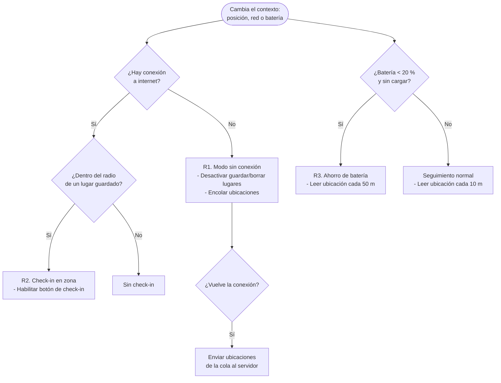

# Reglas de contexto

## Variables de contexto

| Variable | Fuente | Valores |
|---|---|---|
| Zona | GPS + lugares guardados del usuario | Dentro del radio de un lugar / fuera de zona |
| Conexión | `@capacitor/network` (evento `networkStatusChange`) | Con conexión (Wi-Fi o datos) / sin conexión |
| Batería | `@capacitor/device` (`getBatteryInfo`, cada 30 s) | Nivel de 0 a 100 % y si se está cargando |

## Reglas de decisión

| Regla | Si | Entonces |
|---|---|---|
| R1. Modo sin conexión | No hay conexión a internet | Se desactivan guardar y borrar lugares; las ubicaciones se guardan en una cola local y se envían al volver la conexión |
| R2. Check-in en zona | Estás dentro del radio de un lugar **y** hay conexión | Se habilita el botón "Hacer check-in", que envía una notificación por Gotify |
| R3. Ahorro de batería | Batería menor a 20 % **y** no se está cargando | El seguimiento lee la ubicación cada 50 m en lugar de cada 10 m |

Las reglas son independientes: pueden cumplirse varias a la vez (por ejemplo R2 y R3).
R1 y R2 son excluyentes, porque R2 exige conexión.

## Diagrama

## Escenarios de prueba

Automatizados en `app/src/app/context/rules.spec.ts` (`npx vitest run src/app/context/rules.spec.ts --globals` desde `app/`):

| # | Zona | Conexión | Batería | Reglas activas | Resultado esperado |
|---|---|---|---|---|---|
| 1 | Universidad | Sí | 80 % | R2 | Aparece "Hacer check-in"; lectura cada 10 m |
| 2 | Universidad | No | 80 % | R1 | Aviso de sin conexión; guardar/borrar desactivados; sin check-in; ubicaciones en cola |
| 3 | Fuera | Sí | 15 %, sin cargar | R3 | Aviso de ahorro; lectura cada 50 m |
| 4 | Fuera | Sí | 15 %, cargando | Ninguna | Comportamiento normal |
| 5 | Universidad | Sí | 10 %, sin cargar | R2 y R3 | Check-in disponible y ahorro de batería |
| 6 | Fuera | No | 10 %, sin cargar | R1 y R3 | Sin conexión y ahorro de batería |

Casos límite: batería exactamente al 20 % no activa R3 (debe ser menor); batería desconocida
(navegador sin Battery API) tampoco.

En el dispositivo, la pantalla **Reglas** muestra los valores reales de cada variable, qué reglas
están activas y permite simular cada variable para reproducir los escenarios.
